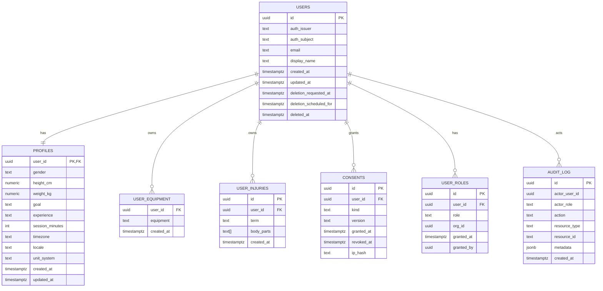

# Data model

## Conventions

- UUID primary keys (`gen_random_uuid()`), except external provider ids.
- `timestamptz` for all timestamps; store UTC.
- `created_at`, `updated_at`, optional `deleted_at`.
- Soft delete by default; hard delete through retention jobs.
- `version` integer for optimistic concurrency on mutable resources.
- `org_id` on every tenant-owned table (P2); `owner_user_id` on user-owned tables.
- No raw health data in audit metadata or logs.
- JSONB only for snapshots/metadata that do not need relational queries.

---

## P0.1 ERD



### `users`

| Column | Type | Notes |
|---|---|---|
| `id` | uuid | PK |
| `auth_issuer` | text | OIDC `iss` |
| `auth_subject` | text | OIDC `sub` |
| `email` | text | optional; normalized lowercase, only if verified |
| `display_name` | text | optional |
| `created_at` | timestamptz | |
| `updated_at` | timestamptz | |
| `deletion_requested_at` | timestamptz | set by `DELETE /me` |
| `deletion_scheduled_for` | timestamptz | hard-delete deadline |
| `deleted_at` | timestamptz | soft delete |

Indexes: unique `(auth_issuer, auth_subject)`; index `lower(email)` if email
search is needed. A subject is scoped by issuer so two providers cannot collide.

### `profiles`

One row per user. PK/FK `user_id`.

Allowed values:

- `gender`: `male`, `female`
- `goal`: `muscle_gain`, `fat_loss`, `general_health`
- `experience`: `beginner`, `intermediate`, `advanced`
- `session_minutes`: `30`, `45`, `60`, `90`
- `unit_system`: `metric`, `imperial`
- `timezone`: IANA name, validated
- `locale`: `id-ID`, `en-US` initially

### `user_equipment`

Composite PK `(user_id, equipment)`. Equipment values come from the domain
enum. Empty list means “all equipment allowed”, not “none”.

### `user_injuries`

- `term` is the normalized user-facing term (`knee`, `lower back`, ...).
- `body_parts` is the resolved domain mapping at write time (for audit and
  filtering). It is `text[]` on Postgres and JSON on SQLite for local tests.
- Unique `(user_id, term)`.
- Requires active `health_data_processing` consent.
- Unknown terms are rejected before insert.
- Revoking health consent deletes the user's injury rows immediately.

### `consents`

- `kind`: `health_data_processing`, `research_analytics`, `trainer_sharing`,
  `marketing`.
- `version`: policy version, e.g. `2026-01`.
- `granted_at` / `revoked_at`.
- Active consent = latest row for `(user_id, kind)` with `revoked_at IS NULL`.
- `ip_hash` is optional and hashed; never store raw IP.
- A policy-version change revokes the old record and inserts a new grant.
- Revoking `health_data_processing` deletes stored injuries.

### `user_roles`

- `role`: `user`, `trainer`, `org_admin`, `platform_admin`.
- `org_id`: null for platform roles; required for org roles.
- Unique `(user_id, role, org_id)`, with a partial unique index for `org_id IS
  NULL` (Postgres treats NULLs as distinct, so a plain unique constraint is not
  enough).
- Default `user` is inserted at first login.
- `platform_admin` is seeded manually; never via API.
- Service clients are **not** users; they live in a separate `api_clients`
  table (P2) with hashed keys and scopes.

### `audit_log`

- Append-only.
- `actor_user_id`/`actor_role` may be null for system actions.
- `metadata` must not contain injury terms, notes, tokens, or raw PII.
- Indexes: `(actor_user_id, created_at)`, `(resource_type, resource_id)`,
  `(created_at)`.

---

## P0.2 plan tables

```text
plans
  id, owner_user_id, title, status, current_version, revision,
  input_snapshot jsonb, seed, dataset_version, algorithm_version,
  split_type, day_count, bmi, bmi_category,
  idempotency_key, idempotency_hash,
  created_at, updated_at, deleted_at

plan_versions
  id, plan_id, version, split_type, schedule jsonb, warnings jsonb,
  day_count, created_at, created_by

plan_days
  id, plan_version_id, day_number, focus, created_at

plan_exercises
  id, plan_day_id, exercise_id, exercise_name, body_part,
  equipment jsonb, primary_muscle jsonb, secondary_muscle jsonb,
  image_url, position, locked, created_at

plan_shares
  id, plan_id, token_hash, expires_at, revoked_at, created_at
```

Rules:

- `plan_versions`/`plan_days`/`plan_exercises` are immutable snapshots.
- `plans.current_version` points to the latest version.
- `plans.revision` is the optimistic-concurrency counter; every edit increments
  it.
- `locked` is stored on the exercise snapshot. There is no separate
  `plan_locks` table in P0.2.
- A share token is random, hashed (SHA-256), expiring, and read-only.
- `plan_exercises` denormalizes exercise display data so old plans remain
  readable if the dataset changes.
- Swap/regenerate creates a new version; lock is copied into the new version.
- `plans.idempotency_key` is unique per owner with a partial index; delete
  clears it so the key can be reused.
- Soft-deleted plans are excluded from list/detail; versions remain for
  audit/recovery.

---

## P0.3 workout tables

```text
workout_sessions
  id, owner_user_id, plan_id, plan_version_id, plan_day_id,
  day_number, title, focus, status, timezone, injuries jsonb,
  started_at, completed_at, notes, client_session_id,
  total_sets, total_reps, total_volume_kg, exercise_count,
  duration_seconds, created_at, updated_at, deleted_at

workout_exercises
  id, workout_session_id, source_plan_exercise_id,
  exercise_id, exercise_name, body_part, equipment jsonb,
  primary_muscle jsonb, secondary_muscle jsonb, image_url,
  position, notes, substituted_from_exercise_id, created_at

set_logs
  id, workout_exercise_id, owner_user_id, set_number,
  reps, weight_kg, rpe, completed, notes, client_set_id,
  created_at, updated_at, deleted_at

client_mutations
  id, owner_user_id, client_mutation_id, mutation_type,
  result jsonb, occurred_at, applied_at, created_at
```

Rules:

- `client_session_id` is unique per user when present.
- `client_set_id` is unique per user when present.
- `(workout_exercise_id, set_number)` is unique among non-deleted sets.
- Timestamps UTC; the session stores the user's IANA timezone for display.
- Sets are soft-deleted; workout history is retained.
- `plan_id`/`plan_version_id`/`plan_day_id` use `SET NULL` so history survives
  plan cleanup.
- `injuries` is a snapshot copied at start for substitution safety.
- `client_mutations` stores the applied result; replay returns it without
  applying the mutation again.

---

## P0.4 feedback and safety

```text
feedback
  id, owner_user_id, plan_id, plan_version_id, workout_session_id,
  rating, difficulty, pain, pain_area, comment, created_at

unsafe_reports
  id, reporter_user_id, plan_id, plan_exercise_id, workout_session_id,
  exercise_id, exercise_name, reason, severity, status,
  resolution_note, resolved_by, triaged_at, resolved_at,
  created_at, updated_at
```

Rules:

- `severity`: `low`, `medium`, `high`, `critical`.
- `status`: `open`, `triaged`, `resolved`, `dismissed`.
- Allowed transitions: open → triaged/resolved/dismissed; triaged →
  resolved/dismissed; resolved/dismissed are terminal.
- Context IDs use `SET NULL` on hard delete so safety records survive.
- `reason`, `resolution_note`, comments, and pain areas are sensitive; never
  log them or put them in audit metadata.
- Critical reports trigger an optional operator webhook.
- Feedback/safety submissions are rate-limited per user per hour.

---

## P1.1 progress tables

```text
daily_metrics
  id, owner_user_id, metric_date, timezone,
  workouts_completed, total_sets, total_reps, total_volume_kg,
  duration_seconds, sets_by_body_part jsonb, volume_by_body_part jsonb,
  created_at, updated_at

personal_records
  id, owner_user_id, exercise_id, exercise_name, record_type,
  value, reps, weight_kg, achieved_at, set_log_id, created_at, updated_at

weekly_reviews
  id, owner_user_id, week_start, timezone,
  workouts_completed, total_sets, total_reps, total_volume_kg,
  duration_seconds, sets_by_body_part jsonb, volume_by_body_part jsonb,
  summary, created_at, updated_at
```

Rules:

- `daily_metrics` unique per `(owner_user_id, metric_date)`.
- `weekly_reviews` unique per `(owner_user_id, week_start)`; weeks start Monday.
- `personal_records` unique per `(owner_user_id, exercise_id, record_type)`;
  record types are `max_weight`, `max_reps`, `max_volume`.
- Only completed workouts and non-deleted, completed sets count.
- Rebuild-on-read replaces the requested daily/week ranges and all-time PRs, so
  deleted sets/workouts cannot leave stale totals.
- Local dates use the requested/profile timezone.

---

## P1.2 trainer tables

```text
trainer_profiles
  id, user_id, display_name, bio, specialties jsonb,
  years_experience, created_at, updated_at

trainer_clients
  id, trainer_user_id, client_user_id, status, created_at,
  updated_at, revoked_at

trainer_invitations
  id, trainer_user_id, client_user_id, client_email, token_hash,
  requested_scopes jsonb, status, message, expires_at,
  accepted_at, declined_at, revoked_at, created_at, updated_at

access_grants
  id, trainer_client_id, scope, granted_at, revoked_at,
  created_at, updated_at

plan_reviews
  id, plan_id, plan_version_id, trainer_user_id, status, note,
  created_at, updated_at

trainer_comments
  id, trainer_user_id, client_user_id, plan_id, workout_session_id,
  body, created_at
```

Rules:

- `trainer_clients` unique per trainer/client.
- `access_grants` unique per relationship/scope; scopes are `plans`,
  `workouts`, `feedback`, `progress`.
- Invitation tokens are hashed, expire after 14 days, and are shown once.
- `plan_reviews` unique per plan/trainer; statuses are `pending`, `approved`,
  `changes_requested`.
- Client/context IDs use `SET NULL` where history should survive.
- Comments, emails, and review notes are sensitive; never log them or put them
  in audit metadata.
- Client revocation sets the relationship and all grants to revoked.

---

## P1.3 notification tables

```text
notification_preferences
  id, owner_user_id, email_enabled, push_enabled, whatsapp_enabled,
  reminder_enabled, reminder_time, timezone,
  quiet_hours_start, quiet_hours_end, weekly_review_enabled,
  calendar_token_hash, calendar_token_created_at, created_at, updated_at

devices
  id, owner_user_id, platform, device_name, token_hash,
  token_ciphertext, last_seen_at, created_at, updated_at

notification_outbox
  id, owner_user_id, channel, template, payload jsonb, scheduled_at,
  status, attempts, max_attempts, idempotency_key, last_error,
  sent_at, created_at, updated_at

integration_tokens
  id, owner_user_id, provider, external_user_id,
  access_token_ciphertext, refresh_token_ciphertext, scopes jsonb,
  expires_at, status, created_at, updated_at
```

Rules:

- `notification_preferences` one row per user.
- Device tokens are hashed for lookup and encrypted (Fernet) for delivery.
- Outbox `idempotency_key` is unique; retries/backoff update the same row.
- Integration tokens are encrypted and never returned raw.
- Calendar/unsubscribe tokens are random or HMAC-signed and contain no PII.
- Quiet hours may wrap midnight; due reminders are suppressed inside them.
- Raw device/integration tokens never appear in logs or audit metadata.

---

## P2.1 organization tables (free, no billing)

```text
organizations
  id, name, slug (unique), type, description, website, timezone,
  branding jsonb, status, created_by, created_at, updated_at

organization_memberships
  id, organization_id, user_id, role, status,
  created_at, updated_at, revoked_at

organization_invitations
  id, organization_id, email, role, token_hash (unique), status,
  invited_by, expires_at, accepted_at, declined_at,
  created_at, updated_at
```

Rules:

- Membership is unique per `(organization_id, user_id)`.
- Roles are `owner`, `admin`, `trainer`, `member`; invitations cannot grant
  `owner`.
- At least one active owner must remain.
- Invitation tokens are hashed, expire after 14 days, and are shown once.
- Organization membership never grants access to health rows. Trainer access
  still requires a P1.2 relationship + scope grant.
- No billing, subscription, entitlement, invoice, or seat tables exist by
  design.

---

## P2.2/P2.3 tables (summary)

| Phase | Tables |
|---|---|
| P2.2 | `events`, `experiments`, `assignments`, `quality_reviews` |
| P2.3 | no new domain tables; operational infrastructure |

---

## Invariants

1. One `profiles` row per `users` row.
2. `(auth_issuer, auth_subject)` is unique and immutable.
3. Injuries cannot be stored without active health-data consent.
4. `platform_admin` cannot be granted through the public API.
5. A trainer can access a client only through an active `access_grant`.
6. Health rows remain user-owned; organization membership and org `org_id`
   columns never grant health-data access on their own.
7. A share token never includes user id, email, injury data, or notes.
8. A workout set is unique per `(user_id, client_mutation_id)`.
9. Audit rows are append-only.
10. A trainer can read client data only through an active relationship and an
    active scope grant; revocation is effective immediately.
11. Soft-deleted or deletion-pending users cannot authenticate; their data is
    removed by a retention job.

---

## Migration order

1. `users`
2. `profiles`
3. `user_equipment`
4. `user_injuries`
5. `consents`
6. `user_roles`
7. `audit_log`
8. `plans` → `plan_versions` → `plan_days` → `plan_exercises` →
   `plan_locks` → `plan_shares`
9. `workout_sessions` → `workout_exercises` → `set_logs` →
   `client_mutations`
10. `feedback` → `unsafe_reports`
11. `daily_metrics` → `personal_records` → `weekly_reviews`
12. `trainer_profiles` → `trainer_clients` → `trainer_invitations` →
    `access_grants` → `plan_reviews` → `trainer_comments`
13. `notification_preferences` → `devices` → `notification_outbox` →
    `integration_tokens`
14. `organizations` → `organization_memberships` →
    `organization_invitations`
15. P2.2 tables

Steps 1–7 are implemented in `migrations/versions/0001_identity_profiles.py`.
The P0.2 plan tables are implemented in
`migrations/versions/0002_plans.py`. The P0.3 workout tables are implemented in
`migrations/versions/0003_workouts.py`. The P0.4 feedback/safety tables are
implemented in `migrations/versions/0004_feedback.py`. The P1.1 progress tables
are implemented in `migrations/versions/0005_progress.py`. The P1.2 trainer
tables are implemented in `migrations/versions/0006_trainer.py`. The P1.3
notification tables are implemented in
`migrations/versions/0007_notifications.py`. The P2.1 organization tables are
implemented in `migrations/versions/0008_organizations.py`. Each migration must
be reversible where practical, and tested against a fresh database. All
migrations are tested on SQLite (upgrade + downgrade); the Postgres runbook is
in `hosting.md`.

---

## Retention and deletion

- `DELETE /me` sets `deletion_requested_at` and `deletion_scheduled_for`
  immediately and blocks authentication.
- A retention job performs the hard delete after the grace window (default 30
  days) unless legal/audit retention applies. The job is not implemented yet.
- Account deletion removes profile, injuries, equipment, plans, workouts,
  feedback, and consents; audit rows are retained without PII.
- Research export uses aggregate or de-identified data only.
- Backups follow the same retention policy; document restore and purge.
