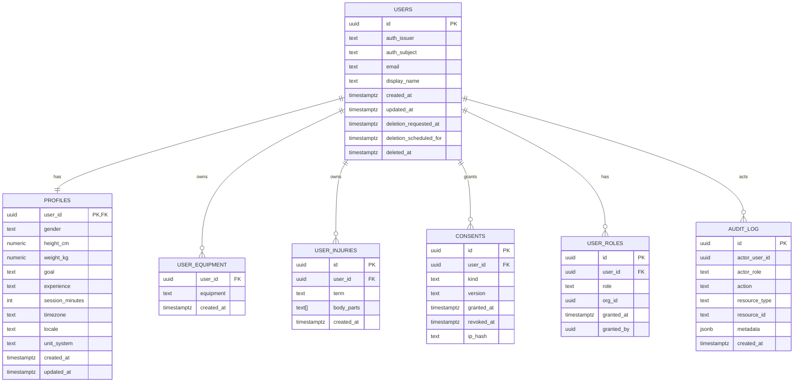

# Data model

## Conventions

- UUID primary keys (`gen_random_uuid()`), except external provider ids.
- `timestamptz` for all timestamps; store UTC.
- `created_at`, `updated_at`, optional `deleted_at`.
- Soft delete by default; hard delete through retention jobs.
- `version` integer for optimistic concurrency on mutable resources.
- `org_id` on every tenant-owned table (P2); `owner_user_id` on user-owned tables.
- No raw health data in audit metadata or logs.
- JSONB only for snapshots/metadata that do not need relational queries.

---

## P0.1 ERD



### `users`

| Column | Type | Notes |
|---|---|---|
| `id` | uuid | PK |
| `auth_issuer` | text | OIDC `iss` |
| `auth_subject` | text | OIDC `sub` |
| `email` | text | optional; normalized lowercase, only if verified |
| `display_name` | text | optional |
| `created_at` | timestamptz | |
| `updated_at` | timestamptz | |
| `deletion_requested_at` | timestamptz | set by `DELETE /me` |
| `deletion_scheduled_for` | timestamptz | hard-delete deadline |
| `deleted_at` | timestamptz | soft delete |

Indexes: unique `(auth_issuer, auth_subject)`; index `lower(email)` if email
search is needed. A subject is scoped by issuer so two providers cannot collide.

### `profiles`

One row per user. PK/FK `user_id`.

Allowed values:

- `gender`: `male`, `female`
- `goal`: `muscle_gain`, `fat_loss`, `general_health`
- `experience`: `beginner`, `intermediate`, `advanced`
- `session_minutes`: `30`, `45`, `60`, `90`
- `unit_system`: `metric`, `imperial`
- `timezone`: IANA name, validated
- `locale`: `id-ID`, `en-US` initially

### `user_equipment`

Composite PK `(user_id, equipment)`. Equipment values come from the domain
enum. Empty list means “all equipment allowed”, not “none”.

### `user_injuries`

- `term` is the normalized user-facing term (`knee`, `lower back`, ...).
- `body_parts` is the resolved domain mapping at write time (for audit and
  filtering). It is `text[]` on Postgres and JSON on SQLite for local tests.
- Unique `(user_id, term)`.
- Requires active `health_data_processing` consent.
- Unknown terms are rejected before insert.
- Revoking health consent deletes the user's injury rows immediately.

### `consents`

- `kind`: `health_data_processing`, `research_analytics`, `trainer_sharing`,
  `marketing`.
- `version`: policy version, e.g. `2026-01`.
- `granted_at` / `revoked_at`.
- Active consent = latest row for `(user_id, kind)` with `revoked_at IS NULL`.
- `ip_hash` is optional and hashed; never store raw IP.
- A policy-version change revokes the old record and inserts a new grant.
- Revoking `health_data_processing` deletes stored injuries.

### `user_roles`

- `role`: `user`, `trainer`, `org_admin`, `platform_admin`.
- `org_id`: null for platform roles; required for org roles.
- Unique `(user_id, role, org_id)`, with a partial unique index for `org_id IS
  NULL` (Postgres treats NULLs as distinct, so a plain unique constraint is not
  enough).
- Default `user` is inserted at first login.
- `platform_admin` is seeded manually; never via API.
- Service clients are **not** users; they live in a separate `api_clients`
  table (P2) with hashed keys and scopes.

### `audit_log`

- Append-only.
- `actor_user_id`/`actor_role` may be null for system actions.
- `metadata` must not contain injury terms, notes, tokens, or raw PII.
- Indexes: `(actor_user_id, created_at)`, `(resource_type, resource_id)`,
  `(created_at)`.

---

## P0.2 plan tables

```text
plans
  id, owner_user_id, title, status, current_version,
  input_snapshot jsonb, seed, dataset_version, algorithm_version,
  created_at, updated_at, deleted_at

plan_versions
  id, plan_id, version, split_type, schedule jsonb,
  warnings jsonb, created_at, created_by

plan_days
  id, plan_version_id, day_number, focus

plan_exercises
  id, plan_day_id, exercise_id, exercise_name, body_part,
  equipment jsonb, primary_muscle jsonb, secondary_muscle jsonb,
  image_url, position, locked

plan_shares
  id, plan_id, token_hash, expires_at, revoked_at, created_at

plan_locks
  id, plan_id, plan_exercise_id, created_at
```

Rules:

- `plan_versions` are immutable snapshots.
- `plans.current_version` points to the latest version.
- A share token is random, hashed, expiring, and read-only.
- `plan_exercises` denormalizes exercise display data so old plans remain
  readable if the dataset changes.
- Swap creates a new version; lock is stored on the exercise.

---

## P0.3 workout tables

```text
workout_sessions
  id, owner_user_id, plan_id, plan_version_id, status,
  started_at, completed_at, notes, created_at, updated_at

workout_exercises
  id, workout_session_id, plan_exercise_id, exercise_id,
  position, notes

set_logs
  id, workout_exercise_id, set_number, reps, weight_kg, rpe,
  completed, client_set_id, created_at, updated_at, deleted_at

client_mutations
  id, owner_user_id, client_mutation_id, entity_type,
  entity_id, payload jsonb, applied_at, created_at
```

Rules:

- `client_mutation_id` unique per user for idempotent offline sync.
- `client_set_id` unique per workout exercise.
- Timestamps UTC; display in profile timezone.
- Workout history is soft-deleted, not destroyed.

---

## P0.4 feedback and safety

```text
feedback
  id, owner_user_id, plan_id, plan_version_id, workout_session_id,
  rating, difficulty, pain, pain_area, comment, created_at

unsafe_reports
  id, reporter_user_id, plan_id, plan_exercise_id, exercise_id,
  reason, severity, status, resolution_note, resolved_by,
  created_at, resolved_at
```

Rules:

- `severity`: `low`, `medium`, `high`, `critical`.
- `status`: `open`, `triaged`, `resolved`, `dismissed`.
- Critical reports alert the operator.
- Comments are PII; do not log them.

---

## P1/P2 tables (summary)

| Phase | Tables |
|---|---|
| P1.1 | `daily_metrics`, `personal_records`, `weekly_reviews` |
| P1.2 | `trainer_profiles`, `trainer_clients`, `invitations`, `access_grants`, `plan_reviews`, `comments` |
| P1.3 | `notification_preferences`, `devices`, `integration_tokens`, `outbox` |
| P2.1 | `organizations`, `memberships`, `subscriptions`, `entitlements`, `invoices`, `api_clients` |
| P2.2 | `events`, `experiments`, `assignments`, `quality_reviews` |
| P2.3 | no new domain tables; operational infrastructure |

---

## Invariants

1. One `profiles` row per `users` row.
2. `(auth_issuer, auth_subject)` is unique and immutable.
3. Injuries cannot be stored without active health-data consent.
4. `platform_admin` cannot be granted through the public API.
5. A trainer can access a client only through an active `access_grant`.
6. Org-owned rows always carry `org_id`; user-owned rows always carry
   `owner_user_id`.
7. A share token never includes user id, email, injury data, or notes.
8. A workout set is unique per `(user_id, client_mutation_id)`.
9. Audit rows are append-only.
10. Soft-deleted or deletion-pending users cannot authenticate; their data is
    removed by a retention job.

---

## Migration order

1. `users`
2. `profiles`
3. `user_equipment`
4. `user_injuries`
5. `consents`
6. `user_roles`
7. `audit_log`
8. `plans` → `plan_versions` → `plan_days` → `plan_exercises` →
   `plan_locks` → `plan_shares`
9. `workout_sessions` → `workout_exercises` → `set_logs` →
   `client_mutations`
10. `feedback` → `unsafe_reports`
11. P1/P2 tables

Steps 1–7 are implemented in `migrations/versions/0001_identity_profiles.py`.
Each migration must be reversible where practical, and tested against a fresh
database. The P0.1 migration is tested on SQLite (upgrade + downgrade); the
Postgres runbook is in `hosting.md`.

---

## Retention and deletion

- `DELETE /me` sets `deletion_requested_at` and `deletion_scheduled_for`
  immediately and blocks authentication.
- A retention job performs the hard delete after the grace window (default 30
  days) unless legal/audit retention applies. The job is not implemented yet.
- Account deletion removes profile, injuries, equipment, plans, workouts,
  feedback, and consents; audit rows are retained without PII.
- Research export uses aggregate or de-identified data only.
- Backups follow the same retention policy; document restore and purge.
